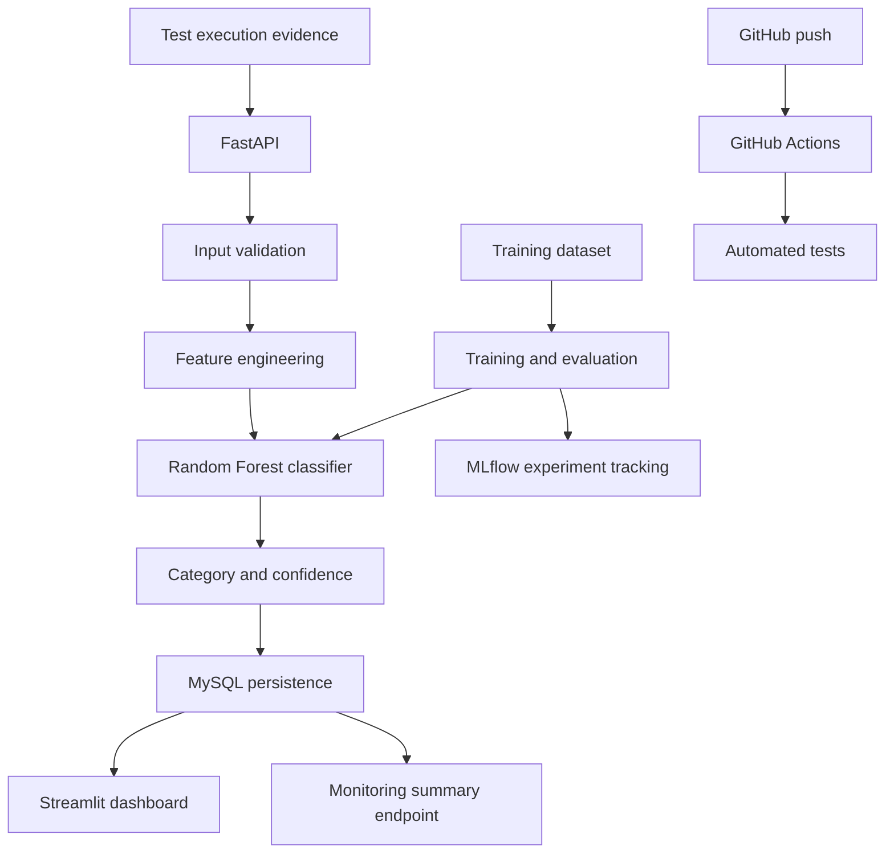

# AI Test Evidence Intelligence

An ML-powered application that analyzes failed software test executions, predicts likely failure categories, and stores results for review in an interactive dashboard.

**Project status:** Local end-to-end workflow verified. Docker Compose, MySQL, FastAPI, Streamlit, MLflow experiment tracking, automated tests, GitHub Actions CI, and a basic prediction-monitoring endpoint are implemented. The model currently uses synthetic data; real-world accuracy has not been established. No live AWS deployment is claimed.

## Problem

Software test failures can result from product defects, flaky tests, environment problems, or test-data issues. This project explores how execution metadata and error-message indicators can help categorize failed test runs for investigation.

## Features

- **Machine learning:** Scikit-learn Random Forest classifier for `REAL_BUG`, `FLAKY`, `ENVIRONMENT`, and `DATA_ISSUE`.
- **Feature engineering:** Execution time, retry count, error-message indicators, environment indicators, and timestamp-derived features.
- **REST API:** FastAPI endpoints for health checks, predictions, and monitoring summaries.
- **Database persistence:** MySQL stores execution records and prediction results.
- **Interactive dashboard:** Streamlit interface for exploring test records and prediction confidence.
- **Experiment tracking:** MLflow tracks training experiments and registered model versions.
- **Prediction monitoring:** Summarizes prediction volume, average confidence, category distribution, and first/latest prediction timestamps.
- **Containerization:** Docker and Docker Compose run the API, dashboard, and MySQL database.
- **Automated testing:** Pytest tests for API behavior, monitoring, and feature engineering.
- **Continuous integration:** GitHub Actions runs automated tests.

## Architecture



## Technology stack

| Area | Technologies |
|---|---|
| Language and data processing | Python, Pandas |
| Machine learning | Scikit-learn, Joblib |
| API | FastAPI, Uvicorn |
| Dashboard | Streamlit |
| Database | MySQL |
| Experiment tracking | MLflow |
| Containerization | Docker, Docker Compose |
| Testing | Pytest |
| Continuous integration | GitHub Actions |

## Repository structure

```text
test-flakiness-predictor/
├── .github/
│   └── workflows/
│       └── tests.yml
├── docker/
│   └── mysql/
│       └── init.sql
├── data/
│   ├── raw/
│   │   └── test_executions.csv
│   └── processed/
├── models/
│   └── flaky_test_classifier.joblib
├── src/
│   ├── api.py
│   ├── database.py
│   ├── explore_data.py
│   ├── features.py
│   ├── generate_data.py
│   ├── monitoring.py
│   ├── predict.py
│   └── train.py
├── tests/
│   ├── test_api.py
│   └── test_features.py
├── dashboard.py
├── Dockerfile
├── docker-compose.yml
├── .dockerignore
├── requirements.txt
└── README.md
```

## Dataset and limitations

The current dataset contains 1,000 synthetically generated records. It is intended for development and demonstration, not as evidence of performance on real production test logs.

Synthetic data may contain patterns that make classification easier than it would be on real-world data. Predictions are decision-support signals, not proof of the underlying root cause. Confidence scores are not guarantees of correctness.

Any evaluation metrics reported from a particular training run should be interpreted in the context of the dataset, train/test split, and evaluation procedure. They should not be treated as production performance.

## Quick start with Docker

### Prerequisites

- Docker Desktop installed and running
- Git

### 1. Clone the repository

```bash
git clone https://github.com/Benaruth22/ai-test-evidence-intelligence.git
cd ai-test-evidence-intelligence
```

### 2. Start the application

```bash
docker compose up -d --build
```

This starts the API, Streamlit dashboard, and MySQL database.

### 3. Open the services

| Service | Local URL |
|---|---|
| FastAPI | http://localhost:8000 |
| Interactive API documentation | http://localhost:8000/docs |
| Health check | http://localhost:8000/health |
| Prediction monitoring | http://localhost:8000/monitoring/summary |
| Streamlit dashboard | http://localhost:8502 |

The dashboard uses port `8502` in the current Docker Compose configuration.

### 4. Check container status

```bash
docker compose ps
```

### 5. View application logs

```bash
docker compose logs -f api
```

To view logs for all services:

```bash
docker compose logs -f
```

### 6. Stop the application

```bash
docker compose down
```

The Compose configuration uses a persistent MySQL volume. To remove the containers and database volume, use `docker compose down -v` only if you intentionally want to delete the persisted database data.

## API usage

### Available endpoints

| Method | Endpoint | Purpose |
|---|---|---|
| `GET` | `/` | API status |
| `GET` | `/health` | Health check |
| `POST` | `/predict` | Predict a failed test's category and save the result |
| `GET` | `/monitoring/summary` | Summarize stored prediction activity |

### Example prediction request

Send a `POST` request to `/predict`:

```json
{
  "test_name": "CheckoutIntegrationTest",
  "execution_time": 35.5,
  "status": "FAIL",
  "error_message": "Timeout waiting for element",
  "environment": "staging",
  "retry_count": 2
}
```

A successful response includes a predicted category, confidence score, database record ID, and save confirmation. Exact response fields and predictions depend on the implementation and model.

Example response shape:

```json
{
  "test_name": "CheckoutIntegrationTest",
  "predicted_category": "FLAKY",
  "confidence": 0.89,
  "database_record_id": 1002,
  "saved_to_database": true
}
```

This is an illustrative response, not a guaranteed result for every input.

### Prediction monitoring

Use:

```bash
curl http://localhost:8000/monitoring/summary
```

The response summarizes:

- Total stored predictions
- Average prediction confidence
- First and latest prediction timestamps
- Prediction counts and average confidence by category

**Monitoring limitation:** This endpoint measures prediction activity and confidence distribution. It does not independently measure model accuracy, confirm root causes, or establish that model drift has occurred.

## Automated tests

Run the tests inside the Docker API container:

```bash
docker compose exec api pytest -v
```

The current verified test suite contains **10 passing tests**.

GitHub Actions is configured to run automated tests when changes are pushed to the repository. See the [GitHub Actions workflow](https://github.com/Benaruth22/ai-test-evidence-intelligence/actions).

## MLflow experiment tracking

The training workflow uses MLflow to track experiments, metrics, parameters, and registered model versions.

For local MLflow usage, follow the tracking configuration in `src/train.py`. If your local setup uses SQLite tracking, start the UI with:

```bash
python -m mlflow ui --backend-store-uri sqlite:///mlflow.db --host 127.0.0.1 --port 5002
```

Then open http://127.0.0.1:5002.

Run this from the project environment where MLflow and its tracking database are configured. The tracking database and model registry are local development artifacts unless separately configured for shared storage.

## Local development

If you want to run the application without Docker, create a virtual environment and install the dependencies:

```bash
python3 -m venv .venv
source .venv/bin/activate
python -m pip install --upgrade pip
pip install -r requirements.txt
```

Then start the API:

```bash
uvicorn src.api:app --reload
```

In another terminal, start the dashboard:

```bash
streamlit run dashboard.py
```

Local development also requires a correctly configured MySQL instance and a compatible trained model artifact. Follow the configuration in the project files before running the application.

## Screenshots and demo

The application has been verified locally. No public hosted demo is currently documented.

Recommended screenshots to add:

```text
docs/
├── dashboard.png
├── swagger-prediction.png
└── mlflow-experiment.png
```

Once captured, embed the screenshots in this section to make the repository easier to explore.

## Roadmap

- Evaluate the model with cross-validation and per-class metrics.
- Validate against realistic, labelled test-execution data.
- Add confirmed-outcome tracking to measure prediction correctness.
- Develop model-drift checks using suitable reference data and statistical methods.
- Improve configuration, secret management, and structured logging.
- Expand CI to include additional quality checks.
- Explore an AWS deployment and document it after it is verified.

## Resume summary

**AI Test Evidence Intelligence** — Built a containerized machine-learning application to classify failed software test executions using Scikit-learn, expose predictions through FastAPI, store execution and prediction data in MySQL, and present results through Streamlit. Integrated MLflow experiment tracking, a prediction-monitoring endpoint, Pytest, Docker Compose, and GitHub Actions CI. Evaluated using a synthetic dataset, with real-world model performance still to be validated.

## Author

**Bena Ruth M.**

AI Engineer | AI Solutions and Automation

- GitHub: https://github.com/Benaruth22
