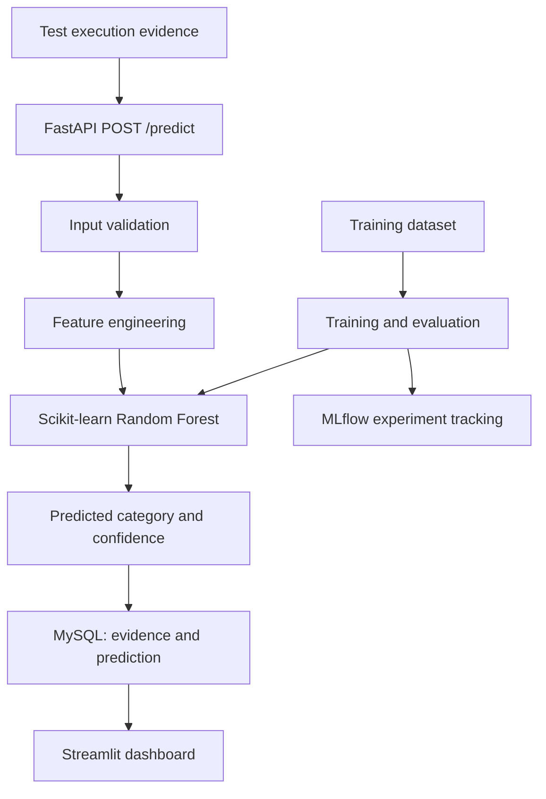
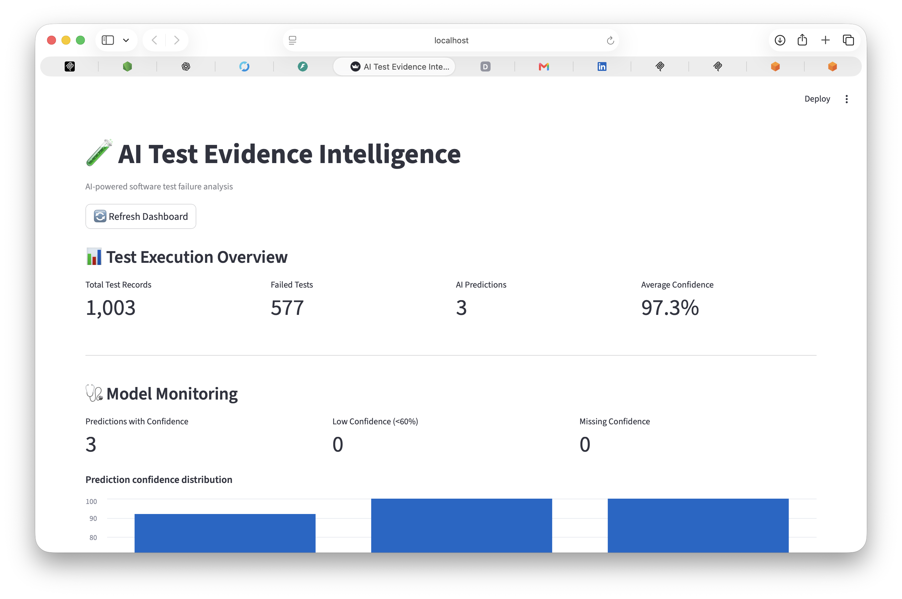

# AI Test Evidence Intelligence

An ML-powered application that analyzes failed software test executions,
predicts likely failure categories, and records results for review in an
interactive dashboard.

> **Project status:** Local end-to-end workflow verified. The model
> currently uses synthetic data. Docker, CI/CD, and AWS deployment are
> not yet documented as completed.

## Problem

Software test failures can come from different causes, including product
defects, flaky tests, environment problems, and test-data issues. This
project explores whether execution metadata and error-message indicators
can help categorize failed test runs for investigation.

## Features

-   **Machine learning:** Random Forest classifier for four failure
    categories:
    -   `REAL_BUG`
    -   `FLAKY`
    -   `ENVIRONMENT`
    -   `DATA_ISSUE`
-   **Feature engineering:** Execution time, retry count, error-message
    indicators, environment indicators, and timestamp-derived features.
-   **REST API:** FastAPI endpoint for submitting failed test evidence
    and receiving a prediction.
-   **Database persistence:** MySQL stores execution evidence and
    prediction results.
-   **Dashboard:** Streamlit interface for exploring test records,
    categories, and prediction confidence.
-   **Experiment tracking:** MLflow tracks training experiments and
    registered model versions.
-   **Automated tests:** Pytest tests for API behavior and feature
    engineering.

## Architecture



## Technology stack

  Area                           Technologies
  ------------------------------ ----------------------
  Language and data processing   Python, Pandas
  Machine learning               Scikit-learn, Joblib
  API                            FastAPI, Uvicorn
  Dashboard                      Streamlit
  Database                       MySQL
  Experiment tracking            MLflow
  Testing                        Pytest

## Repository structure

``` text
test-flakiness-predictor/
├── data/
│   ├── raw/
│   │   └── test_executions.csv
│   └── processed/
├── models/
│   └── flaky_test_classifier.joblib
├── src/
│   ├── api.py
│   ├── database.py
│   ├── explore_data.py
│   ├── features.py
│   ├── generate_data.py
│   ├── monitoring.py
│   ├── predict.py
│   └── train.py
├── tests/
│   ├── test_api.py
│   └── test_features.py
├── dashboard.py
├── requirements.txt
└── README.md
```

## Dataset and limitations

The current dataset contains **1,000 synthetically generated records**.
It is intended for development and demonstration, not as evidence of
performance on real production test logs. The generated data may contain
patterns that make classification easier than it would be on real-world
data.

The model is trained to classify failed test executions. A predicted
category and confidence score are decision-support signals, not proof of
the underlying root cause. The confidence score is not a guarantee of
correctness.

### Current evaluation snapshot

One recorded train/test evaluation produced:

  Metric                                                  Result
  ----------------------------------- --------------------------
  Random Forest accuracy                                  64.15%
  Random Forest macro F1                                  63.91%
  Random Forest weighted F1                               64.19%
  DummyClassifier baseline accuracy                       30.19%
  Accuracy difference over baseline     +33.96 percentage points

These figures are from one held-out split and synthetic data. They
should not be treated as production performance. Further work should
include repeated or cross-validated evaluation, per-class
precision/recall/F1, confusion-matrix review, leakage checks, and
validation on realistic labelled data.

## Local setup

### 1. Clone the repository

After publishing the project to GitHub, use its repository URL:

``` bash
git clone <YOUR_GITHUB_REPOSITORY_URL>
cd test-flakiness-predictor
```

### 2. Create and activate a virtual environment

On macOS:

``` bash
python3 -m venv .venv
source .venv/bin/activate
```

### 3. Install dependencies

``` bash
python -m pip install --upgrade pip
pip install -r requirements.txt
```

### 4. Configure MySQL

Create a MySQL database named `ai_test_intelligence`. Configure
`src/database.py` to connect with a MySQL account that has permission to
create or use the required table. Do not commit passwords or other
credentials to GitHub.

If your project already has a database setup script or schema, follow
that project's existing setup steps.

### 5. Generate or prepare the dataset

Review `src/generate_data.py` before running it, because it may replace
the existing CSV:

``` bash
python -m src.generate_data
```

### 6. Train the model

``` bash
python -m src.train
```

This trains the model and writes the model artifact under `models/`. The
training code also logs experiments to MLflow.

### 7. Start the API

In one terminal:

``` bash
uvicorn src.api:app --reload
```

Open the interactive API documentation at <http://127.0.0.1:8000/docs>.

### 8. Start the dashboard

In a separate terminal with the same virtual environment active:

``` bash
streamlit run dashboard.py
```

Use the local URL printed by Streamlit.

### 9. View MLflow experiments

In another terminal:

``` bash
python -m mlflow ui --backend-store-uri sqlite:///mlflow.db --host 127.0.0.1 --port 5001
```

Open <http://127.0.0.1:5001>.

## API example

Send a failed test execution to `POST /predict`:

``` json
{
  "test_name": "CheckoutIntegrationTest",
  "execution_time": 35.5,
  "status": "FAIL",
  "error_message": "Timeout waiting for element",
  "environment": "staging",
  "retry_count": 2
}
```

A successful response includes the predicted category, confidence,
database record ID, and save confirmation. Example response shape:

``` json
{
  "test_name": "CheckoutIntegrationTest",
  "predicted_category": "FLAKY",
  "confidence": 0.92,
  "predicted_failure_category": "FLAKY",
  "database_record_id": 1003,
  "saved_to_database": true
}
```

The category and confidence above illustrate a response from a local
test run; predictions may differ with the trained model and input data.

### Available endpoints

  Method   Endpoint     Purpose
  -------- ------------ ------------------------------------------
  `GET`    `/`          API status
  `GET`    `/health`    Health check
  `POST`   `/predict`   Predict and save a failed test execution

## Run tests

With the virtual environment active:

``` bash
pytest -v
```

At the time of this README draft, **8 tests passed** in the local
environment.

## Screenshots and demo

Add screenshots after capturing them from the running application.
Suggested files:

``` text
docs/
├── dashboard.png
├── swagger-prediction.png
└── mlflow-experiment.png
```

Then embed them here, for example:

``` markdown

```

No public demo URL is listed yet; the application has been verified
locally.

## Roadmap

-   Improve evaluation with cross-validation, per-class metrics, and
    error analysis.
-   Validate against realistic, labelled test-execution data.
-   Improve configuration, secret management, and structured logging.
-   Add Docker and automated CI/CD.
-   Deploy to a chosen AWS service and document the verified live demo.
-   Add confirmed-outcome tracking and evaluate model drift.

## Resume summary

**AI Test Evidence Intelligence** --- Built a machine-learning
application that classifies failed software test executions using
Scikit-learn, exposes predictions through FastAPI, stores results in
MySQL, and presents test analytics in Streamlit. Integrated MLflow
experiment tracking and Pytest; evaluated a Random Forest against a
DummyClassifier baseline on a synthetic dataset.

## Author

Add your name and preferred professional links here before publishing.
