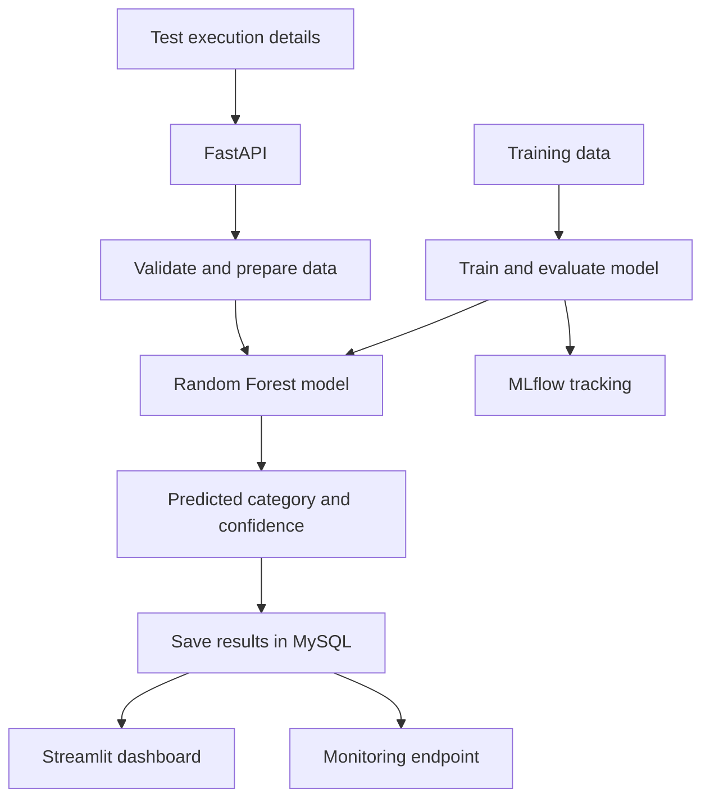

# AI Test Evidence Intelligence

What if we could use AI to help us understand why software tests fail?

That's the idea behind **AI Test Evidence Intelligence**, a project I built to explore how machine learning can help analyze failed software tests and identify their possible causes.

A failed test doesn't always mean there's a bug in the application. Sometimes the test itself is unreliable, the environment has a problem, or the test data isn't correct. I wanted to build a tool that could help categorize these failures and make them easier to investigate.

This project brings together machine learning, backend development, databases, experiment tracking, testing, and containerization in one application.

## What can it do?

- **Predict failure categories:** Uses a Random Forest model to classify failed tests into `REAL_BUG`, `FLAKY`, `ENVIRONMENT`, or `DATA_ISSUE`.
- **Analyze test information:** Uses features such as execution time, retry count, environment, error messages, and timestamps.
- **Provide predictions through an API:** FastAPI accepts test information and returns a predicted category with a confidence score.
- **Store test results:** MySQL keeps track of test executions and their predictions.
- **Explore results visually:** A Streamlit dashboard lets users review test records and prediction information.
- **Monitor predictions:** A monitoring endpoint summarizes prediction counts, confidence, and category distribution.
- **Track ML experiments:** MLflow records training experiments and registered model versions.
- **Run in containers:** Docker Compose brings up the API, dashboard, and MySQL database.
- **Test automatically:** Pytest and GitHub Actions help check that the application continues to work as the code changes.

## How it works



The API receives the test details, prepares the input features, and passes them to the trained model. The prediction is then saved in MySQL so it can be reviewed later.

The dashboard helps explore the results, while the monitoring endpoint provides a simple overview of prediction activity.

## Built with

| Technology | Why I used it |
|---|---|
| Python | Core application and ML logic |
| Pandas | Data processing and feature engineering |
| Scikit-learn | Training and evaluating the classifier |
| FastAPI | Building the prediction API |
| Streamlit | Creating the dashboard |
| MySQL | Storing test records and predictions |
| MLflow | Tracking experiments and model versions |
| Pytest | Testing API behavior and feature engineering |
| Docker Compose | Running the application and database together |
| GitHub Actions | Automating tests when code is pushed |

## Getting started

You'll need Git and Docker Desktop installed and running.

**1. Clone the repository**

```bash
git clone https://github.com/Benaruth22/ai-test-evidence-intelligence.git
cd ai-test-evidence-intelligence
```

**2. Start the application**

```bash
docker compose up -d --build
```

Docker Compose starts the API, dashboard, and MySQL database.

**3. Open the application**

- API documentation: http://localhost:8000/docs
- Health check: http://localhost:8000/health
- Prediction monitoring: http://localhost:8000/monitoring/summary
- Streamlit dashboard: http://localhost:8502

**4. Check that everything is running**

```bash
docker compose ps
```

**5. Run the tests**

```bash
docker compose exec api pytest -v
```

The current test suite has **10 passing tests** in the Docker environment.

When you're finished, stop the containers with:

```bash
docker compose down
```

## A look at the API

The `/predict` endpoint accepts information about a failed test.

For example:

```json
{
  "test_name": "CheckoutIntegrationTest",
  "execution_time": 35.5,
  "status": "FAIL",
  "error_message": "Timeout waiting for element",
  "environment": "staging",
  "retry_count": 2
}
```

The model returns a predicted failure category and confidence score. The result is also saved to MySQL when persistence succeeds.

You can try the endpoint interactively through the FastAPI documentation at `/docs`.

### Prediction monitoring

The `/monitoring/summary` endpoint provides a quick overview of stored predictions, including:

- Total number of predictions
- Average prediction confidence
- Number of predictions in each category
- First and most recent prediction timestamps

This is a starting point for operational monitoring. It doesn't yet tell us whether predictions were correct or whether the model has drifted.

## Machine learning and data

The model uses a Random Forest classifier to predict one of four failure categories.

The current dataset contains **1,000 synthetically generated records**. This made it possible to build and test the complete workflow without depending on a real-world labelled dataset.

There is an important limitation: synthetic data cannot fully represent the complexity of real software testing. A model that performs well on generated examples may behave very differently on actual test logs.

For that reason, the predictions should be treated as suggestions for investigation, not confirmed root causes. The confidence score is also not a guarantee that a prediction is correct.

My next step is to evaluate the model more thoroughly and test it against realistic, labelled data.

## Experiment tracking with MLflow

I integrated MLflow to keep track of training experiments, evaluation metrics, and registered model versions.

This makes it easier to compare experiments and understand how model changes affect results, rather than treating training as a one-time script.

The local MLflow interface can be started with:

```bash
python -m mlflow ui --backend-store-uri sqlite:///mlflow.db --host 127.0.0.1 --port 5002
```

Then visit http://127.0.0.1:5002 from your browser, using the project environment and tracking database configured for your setup.

## What I learned and what comes next

Building this project gave me practical experience connecting an ML model to a working application rather than stopping at model training.

I also worked on API validation, database persistence, automated tests, experiment tracking, Docker, and CI.

There is still more to do. My next goals are to:

- Test the model with realistic software test logs.
- Improve evaluation with cross-validation and per-class metrics.
- Track confirmed outcomes to measure actual prediction accuracy.
- Add more meaningful model-drift monitoring.
- Improve logging and configuration.
- Explore deployment on AWS.

## About this project

I built **AI Test Evidence Intelligence** as part of my journey toward becoming an AI Engineer, with a focus on practical AI applications and software quality.

The goal is to explore how machine learning can support testing teams by making failed test executions easier to organize and investigate.

**Author:** Bena Ruth M.  
**GitHub:** [Benaruth22](https://github.com/Benaruth22)
